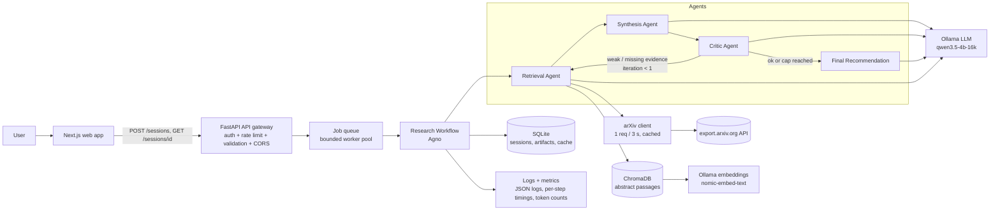
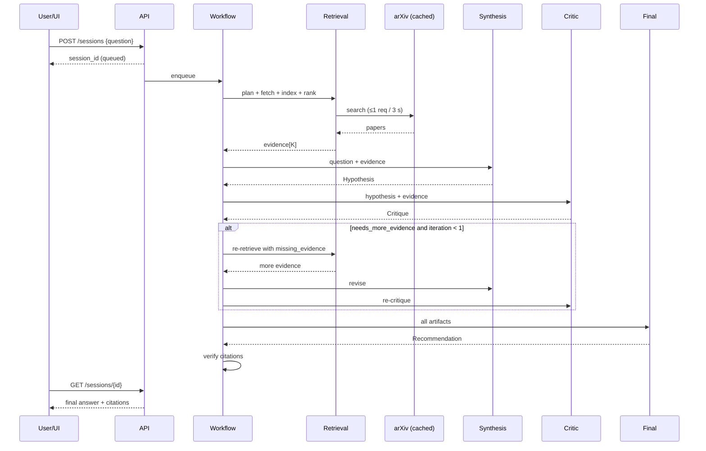

# Mini Research Co-Scientist — Architecture

A local-first multi-agent system that takes a research question, retrieves papers from arXiv, generates a
hypothesis, critiques it, optionally re-retrieves once, and returns an evidence-grounded recommendation with
citations. Everything runs on the developer's machine: no paid APIs, no cloud LLMs.

> Status: design approved for implementation planning. Section 9 is the implementation plan; no code is
> written until it is signed off.

---

## 1. Technology choices

| Concern               | Choice                                                                                                       | Why                                                                                                                                                                                        |
| --------------------- | ------------------------------------------------------------------------------------------------------------ | ------------------------------------------------------------------------------------------------------------------------------------------------------------------------------------------ |
| Agent framework       | **Agno 3.x** (`agno`, latest 3.2.1)                                                                  | Native Ollama model + Ollama embedder + ChromaDB vector store, structured outputs (`output_schema`), workflows, SQLite session storage.                                                  |
| LLM runtime           | **Ollama** (0.40.x installed)                                                                          | Local, OpenAI-style API, tool calling and JSON-schema structured output.                                                                                                                   |
| Reasoning LLM         | `qwen3.5-4b-16k` (already pulled)                                                                          | Qwen family handles structured output well at small size; 16k context fits ~10 abstracts plus prompt. Configurable; `gemma2:9b` is a fallback for synthesis text only (no tool calling). |
| Embedding model       | `nomic-embed-text` (already pulled, 768-dim, 8k ctx)                                                       | Most-used Ollama embedder, tiny (274 MB). Upgrade path: `qwen3-embedding:0.6b` if retrieval quality is weak.                                                                             |
| Vector DB             | **ChromaDB** (1.5.x, embedded `PersistentClient`)                                                    | No server to run; on-disk at `./data/chroma`.                                                                                                                                            |
| arXiv access          | **`arxiv` (arxiv.py, MIT, 4.0.x)** over the official open arXiv API (`export.arxiv.org/api/query`) | Free, no key, metadata is CC0. arxiv.py already handles paging, retries and the 3-second delay. Agno's `ArxivTools` wraps the same library, but we call it from code (see 4.1).          |
| Session / cache store | **SQLite** (Agno `SqliteDb` + one small cache table)                                                 | Single file, zero ops; good enough for ≤50 users on one box.                                                                                                                              |
| API gateway           | **FastAPI** (auth, rate limit, validation, job API) + background worker pool                           | Async job submission and polling; matches the "async job processing" pattern. One service: gateway concerns are FastAPI middleware/dependencies.                                           |
| Frontend              | **Next.js** (App Router, TypeScript)                                                                   | Web app for submitting questions and viewing results/citations; talks only to the FastAPI gateway.                                                                                         |
| E2E tests             | **Playwright** (`@playwright/test`)                                                                  | Drives the Next.js UI against the running FastAPI backend once the app is built.                                                                                                           |
| Packaging             | **uv**, Python 3.14                                                                                    | Already set up; dependencies were checked to resolve on 3.14 (`uv pip compile`).                                                                                                         |

Verified on this machine: `uv 0.13.1`, `ollama 0.40.16`, models `qwen3.5-4b-16k`, `gemma2:9b`,
`nomic-embed-text`, `embeddinggemma-2` present; `agno + chromadb + arxiv + ollama` resolve on Python 3.14.

---

## 2. Review of the original architecture

The diagram is sound as a target design. What changes for a local, Ollama-backed build:

| Item in diagram                                  | Issue                                                                                                                                                                                            | Decision                                                                                                                                                                                                                                                                  |
| ------------------------------------------------ | ------------------------------------------------------------------------------------------------------------------------------------------------------------------------------------------------ | ------------------------------------------------------------------------------------------------------------------------------------------------------------------------------------------------------------------------------------------------------------------------- |
| **≤50 concurrent users, p95 < 2–3 min**  | One local GPU running a 4B model serves roughly 1–4 generations in parallel (`OLLAMA_NUM_PARALLEL`). Each query makes ~4–6 LLM calls. 50 *simultaneous* queries will queue far past 3 min. | Keep the API able to accept 50 users, but run jobs through a bounded worker pool (default 2) with a visible queue position. State the real SLO honestly: p95 < 3 min **at ≤4 in-flight jobs**. Scaling = more Ollama hosts behind a round-robin, not code changes. |
| **arXiv API**                              | arXiv terms: max **1 request / 3 s, single connection, across all your machines**. 50 users hitting it directly would get the IP blocked.                                                  | One process-wide rate-limited arXiv client + a SQLite query/paper cache (TTL 24 h). Retrieval cost per query: 1–2 arXiv calls.                                                                                                                                           |
| **API Gateway (auth, rate limit)**         | A separate gateway product (Kong, etc.) is overkill locally.                                                                                                                                     | FastAPI *is* the gateway: API-key dependency, per-client token-bucket rate limit, request validation, CORS for the Next.js origin.                                                                                                                                      |
| **Retrieval Agent "Extract key evidence"** | arXiv API returns abstracts only. Full-text PDF parsing is slow and noisy.                                                                                                                       | MVP evidence = abstract sentences. PDF full text is a Phase 5 option.                                                                                                                                                                                                     |
| **Agents doing everything via tool calls** | Small local models are unreliable at multi-step tool calling.                                                                                                                                    | LLM decides *what* (search terms, claims, critique); deterministic Python does *how* (call arXiv, embed, rank, verify citations). Each agent returns a Pydantic schema, never free text.                                                                              |
|                                                  |                                                                                                                                                                                                  |                                                                                                                                                                                                                                                                           |
|                                                  |                                                                                                                                                                                                  |                                                                                                                                                                                                                                                                           |
| **Critic → Revise loop**                  | Unbounded loops burn latency.                                                                                                                                                                    | Hard cap: max 1 re-retrieval (2 critique passes total), enforced in code, not by the model.                                                                                                                                                                               |
| **Citation correctness** (eval metric)     | LLMs invent arXiv IDs.                                                                                                                                                                           | Post-check: every cited `arxiv_id` / `evidence_id` must exist in the session's evidence set; unknown citations are stripped and the answer is flagged.                                                                                                                |

---

## 3. High-level architecture



---

## 4. Components

### 4.1 Retrieval Agent

1. **Query planning (LLM):** question → 2–4 arXiv search strings + optional category filter (`cs.*`, `q-bio.*`, …).
   Output schema: `SearchPlan{queries: list[str], categories: list[str]}`.
2. **Fetch (code):** `arxiv.Client(page_size=…, delay_seconds=3, num_retries=3)`, top N=15 per query by relevance,
   de-duplicated by arXiv ID. Results cached in SQLite keyed by normalized query.
3. **Index (code):** split each abstract into sentence-window passages, embed with `nomic-embed-text`
   (`search_document:` prefix), upsert into Chroma collection `passages` with metadata
   `{arxiv_id, title, year, url, session_id}`.
4. **Rank & select (code):** vector search with the question (`search_query:` prefix), keep top K=8 passages
   across ≥3 distinct papers where possible. These become `Evidence` rows.

On a revise pass the agent receives the critic's `missing_evidence` list as extra search intents.

### 4.2 Synthesis Agent (Researcher)

Input: question + numbered evidence passages. Output schema:
`Hypothesis{statement, rationale, supporting_evidence_ids: list[str], assumptions: list[str]}`.
Instruction: every claim must reference evidence IDs; no outside knowledge presented as fact.

### 4.3 Critic Agent

Input: question, hypothesis, evidence. Output schema:
`Critique{unsupported_claims, contradictions, methodology_concerns, missing_evidence: list[str], confidence: float (0–1), needs_more_evidence: bool}`.
Code (not the model) decides the loop:
`revise = critique.needs_more_evidence and iteration < MAX_REVISIONS (1)`.

### 4.4 Final Recommendation

Input: everything above. Output schema:
`Recommendation{conclusion, evidence_backed_points: list[{text, evidence_ids}], inferences: list[str], caveats: list[str], confidence: float, citations: list[{arxiv_id, title, url}]}`.
Then the **citation verifier** (code) drops unknown IDs and sets `status = "insufficient_evidence"` when
fewer than 2 supporting papers remain (FR-7: fail transparently).

### 4.5 Orchestrator (Workflow)

Plain Python orchestration inside an Agno `Workflow` (steps: retrieve → synthesize → critique → [loop] → finalize),
with session state persisted via Agno `SqliteDb`. Per-step timeout (default 90 s) and one retry with backoff
on Ollama/arXiv errors. If the Agno `Loop` primitive fits cleanly in 3.2.1 it replaces the hand-written loop;
otherwise the explicit `for` loop stays (it is three lines and easier to cap).

### 4.6 API gateway (FastAPI)

| Method   | Path               | Purpose                                                                                                                |
| -------- | ------------------ | ---------------------------------------------------------------------------------------------------------------------- |
| `POST` | `/sessions`      | Body `{question}` → `{session_id, status: "queued", position}`                                                    |
| `GET`  | `/sessions/{id}` | Status (`queued/retrieving/synthesizing/critiquing/finalizing/done/failed/insufficient_evidence`) + artifacts so far |
| `GET`  | `/health`        | Ollama reachable, models present, Chroma writable                                                                      |

Validation: question length 10–1000 chars. Rate limit per client. Optional `X-API-Key`. CORS allows the
Next.js origin (`CS_CORS_ORIGINS`, default `http://localhost:3000`). OpenAPI schema at `/openapi.json` is the
contract the frontend types are generated from.

### 4.7 Frontend (Next.js)

- App Router + TypeScript, plain fetch to the gateway (`NEXT_PUBLIC_API_URL`); the browser never talks to Ollama or arXiv.
- Pages: `/` (question form + recent sessions), `/sessions/[id]` (polls status every 2 s; shows step progress,
  hypothesis, critique, final answer split into "Evidence" vs "Inference", clickable arXiv links, confidence, caveats).
- Status changes and errors use stable `data-testid` attributes so Playwright tests don't depend on copy.
- Styling: Tailwind (ships with `create-next-app`); no component library until needed.

### 4.8 End-to-end tests (Playwright)

- Written after the app is built (Phase 6).
- Config starts both servers via `webServer` (FastAPI on :8000, Next.js on :3000).
- Two modes: **mock mode** (`CS_FAKE_LLM=1` — the workflow uses canned agent outputs and a fixture arXiv
  response, fast and deterministic, runs in CI) and **live mode** (real Ollama + arXiv, one smoke test, run manually).
- Scenarios: submit question → see queued → see done with ≥1 citation link to arxiv.org; insufficient-evidence
  path shows the warning; validation error on too-short question; API down shows an error state;
  revise loop shows iteration 2 in the progress view.

---

## 5. Data model

SQLite (relational artifacts) + Chroma (vectors). IDs are UUID4 strings except `arxiv_id`.

| Entity          | Fields                                                                                                   | Store                         |
| --------------- | -------------------------------------------------------------------------------------------------------- | ----------------------------- |
| ResearchSession | id, question, status, iteration, created_at, updated_at, error                                           | SQLite                        |
| Paper           | arxiv_id (PK), title, authors (JSON), abstract, published, categories, url, fetched_at                   | SQLite (also the arXiv cache) |
| Evidence        | id, session_id, paper_id, passage, score, type (`supporting/contradicting/context`), iteration         | SQLite + Chroma doc           |
| Hypothesis      | id, session_id, iteration, statement, rationale, evidence_ids (JSON)                                     | SQLite                        |
| Critique        | id, session_id, iteration, weaknesses, contradictions, missing_evidence, confidence, needs_more_evidence | SQLite                        |
| Recommendation  | id, session_id, conclusion, evidence_points, inferences, caveats, confidence, citations                  | SQLite                        |
| SearchCache     | query_hash, query, arxiv_ids (JSON), fetched_at                                                          | SQLite                        |

Pydantic models double as Agno `output_schema` and as API response models, so there is one definition per entity.

---

## 6. End-to-end sequence



---

## 7. Non-functional design

| NFR                     | Mechanism                                                                                                                                                                  |
| ----------------------- | -------------------------------------------------------------------------------------------------------------------------------------------------------------------------- |
| Concurrency (~50 users) | Async API accepts requests; worker pool size = `CS_WORKERS` (default 2) matched to `OLLAMA_NUM_PARALLEL`; queue position returned.                                     |
| Latency                 | Small model, ≤ 6 LLM calls/query, cached arXiv results, top-K capped, ≤1 revision. Target p95 < 3 min at ≤4 in-flight jobs.                                             |
| Reliability             | Timeouts per step, 1 retry with backoff, arXiv client retries, job state persisted so a crash leaves a `failed` row instead of a hang.                                   |
| Cost                    | $0 runtime; bounded loops cap compute.                                                                                                                                     |
| Observability           | JSON logs with `session_id`, per-step duration, token counts from Agno run metrics, error class. Langfuse (self-hosted) is a later option via OpenTelemetry, not in MVP. |
| Security                | Input validation, optional API key, no secrets needed; arXiv content treated as untrusted text (prompt-injection: evidence is wrapped and labelled as data in prompts).    |

---

## 8. Configuration

`.env` (read with `pydantic-settings`):

```
CS_LLM_MODEL=qwen3.5-4b-16k
CS_EMBED_MODEL=nomic-embed-text
CS_EMBED_DIM=768
OLLAMA_HOST=http://localhost:11434
CS_DATA_DIR=./data
CS_MAX_REVISIONS=1
CS_PAPERS_PER_QUERY=15
CS_TOP_K_EVIDENCE=8
CS_WORKERS=2
CS_STEP_TIMEOUT_S=90
CS_API_KEY=            # empty = auth off
```

### Project layout

```
src/co_scientist/
  __init__.py        # main() -> CLI entry
  config.py          # settings
  schemas.py         # Pydantic entities / agent output schemas
  arxiv_client.py    # rate-limited, cached arXiv search
  store.py           # SQLite tables + Chroma collection
  agents.py          # retrieval-planner, synthesis, critic, final agents (Agno)
  workflow.py        # orchestration, loop cap, citation verifier
  api.py             # FastAPI gateway + worker pool
  fakes.py           # canned LLM/arXiv outputs for CS_FAKE_LLM=1 (Playwright + tests)
web/                 # Next.js app (App Router, TypeScript, Tailwind)
  app/page.tsx
  app/sessions/[id]/page.tsx
  lib/api.ts         # typed client for the FastAPI gateway
  e2e/               # Playwright specs
  playwright.config.ts
tests/               # Python unit + API tests (pytest)
eval/questions.jsonl # small eval set
```

---

## 9. Implementation plan

Each phase ends in something runnable. Phases 0–3 are the MVP vertical slice (CLI answers a question end to end).

### Phase 0 — Setup & spike (≈30 min)

- `uv add agno chromadb arxiv ollama pydantic-settings fastapi uvicorn` (+ `pytest`, `httpx` as dev). Check Node.js ≥ 20 is installed for the Next.js/Playwright phases.
- Spike script: Agno `Agent(model=Ollama(id=CS_LLM_MODEL), output_schema=...)` returns a valid Pydantic object;
  `OllamaEmbedder` + `ChromaDb` round-trip; confirm exact Agno 3.2.1 import paths
  (`agno.models.ollama`, `agno.knowledge.embedder.ollama`, `agno.vectordb.chroma`, `agno.workflow`).
- **Exit:** structured output works with the local model at least 9/10 times; otherwise switch model before going further.

### Phase 1 — Data & retrieval (≈1–1.5 h)

- `config.py`, `schemas.py`, `store.py` (SQLite tables, Chroma collection).
- `arxiv_client.py`: single shared client, 3 s delay, cache lookup first.
- Retrieval: planner agent → fetch → passage split → embed → rank top K.
- **Tests:** cache hit avoids network (mock arxiv); ranking returns ≤K passages from ≥1 paper; rate limiter spacing.
- **Exit:** `co-scientist retrieve "question"` prints ranked evidence with arXiv links.

### Phase 2 — Synthesis & critique (≈1 h)

- Synthesis and Critic agents with output schemas and prompts that label evidence as data.
- **Tests:** schema validation on canned model outputs; prompt contains only session evidence.
- **Exit:** CLI prints hypothesis + critique for a question.

### Phase 3 — Workflow, loop, final answer (≈1 h)

- Workflow orchestration, `MAX_REVISIONS` cap, final agent, citation verifier, `insufficient_evidence` path,
  session persistence, per-step timeout/retry.
- **Tests:** loop never exceeds cap (stub critic always says "need more"); verifier strips fake IDs;
  insufficient-evidence path; one live end-to-end smoke test (marked, skipped if Ollama is down).
- **Exit (MVP):** `co-scientist ask "question"` returns a cited recommendation.

### Phase 4 — FastAPI gateway (≈1 h)

- Endpoints, bounded worker pool, queue position, API key + rate limit, CORS, `/health`, `CS_FAKE_LLM` switch.
- **Tests (pytest + httpx):** contract tests with the workflow stubbed; concurrency test that N submissions never
  exceed `CS_WORKERS` running; 429 on rate limit; 401 with wrong key.
- **Exit:** `uvicorn co_scientist.api:app` serves the full flow; OpenAPI schema published.

### Phase 4b — Next.js frontend (≈1.5 h)

- `create-next-app` in `web/` (TypeScript, App Router, Tailwind), typed API client, question page, session page with polling.
- **Exit:** submit from the browser, watch progress, see final answer with citations.

### Phase 5 — Evaluation & observability (≈1 h)

- `eval/questions.jsonl` (10–15 questions) + script reporting: relevance@K (LLM-judge or manual labels),
  citation correctness (verifier pass rate), critique catch rate on seeded bad hypotheses,
  latency p50/p95, completion/error rate.
- JSON logging with step timings and token counts.
- Optional later: PDF full-text evidence, Langfuse tracing, `qwen3-embedding` A/B.

### Phase 6 — Playwright E2E (≈1 h, after the app is built)

- `npm init playwright` in `web/`, `webServer` config launching FastAPI (fake mode) + Next.js.
- Specs from section 4.8; mock mode in CI, one live smoke spec run manually.
- **Exit:** `npx playwright test` green in mock mode; HTML report saved under `web/playwright-report/`.

### Risks

| Risk                                         | Mitigation                                                                    |
| -------------------------------------------- | ----------------------------------------------------------------------------- |
| 4B model gives invalid JSON / weak reasoning | Phase 0 gate; retry once with validation error in prompt; swap model via env. |
| arXiv throttling or downtime                 | Cache, single rate-limited client, clear `failed` status with reason.       |
| Abstract-only evidence too thin              | `insufficient_evidence` status instead of guessing; PDF parsing in Phase 5. |
| Agno API drift between versions              | Pin `agno` version after Phase 0 spike.                                     |
| GPU memory with LLM + embedder loaded        | Both models together ≈ 3.7 GB; set `OLLAMA_MAX_LOADED_MODELS=2`.           |

---

## 10. References

- arXiv API terms of use (rate limits): https://info.arxiv.org/help/api/tou.html
- arxiv.py: https://github.com/lukasschwab/arxiv.py
- Agno knowledge + ChromaDB: https://docs.agno.com/knowledge/vector-stores/chroma/overview
- Agno Ollama embedder: https://docs.agno.com/knowledge/concepts/embedder/ollama/ollama-embedder
- Agno workflows: https://docs.agno.com/workflows/overview
- Playwright `webServer`: https://playwright.dev/docs/test-webserver
