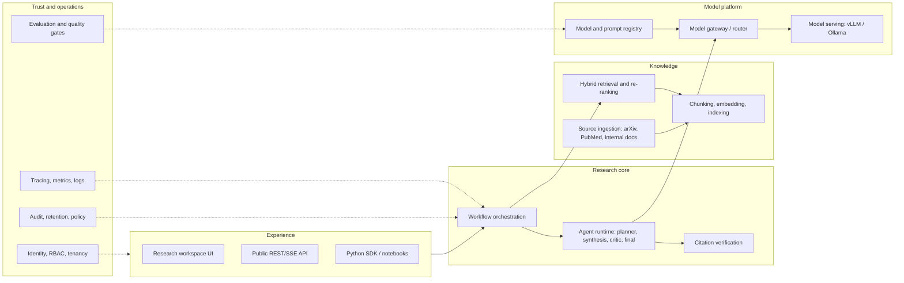
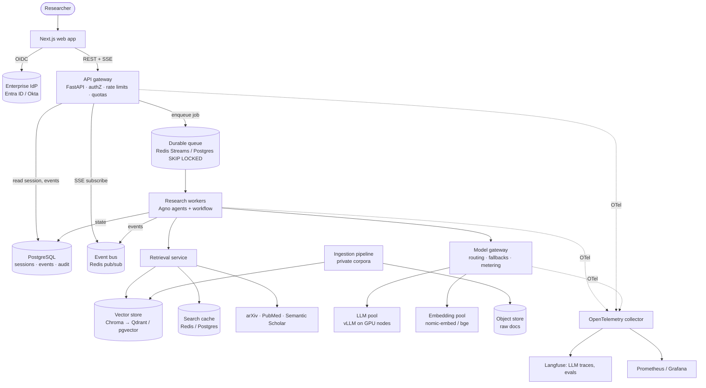
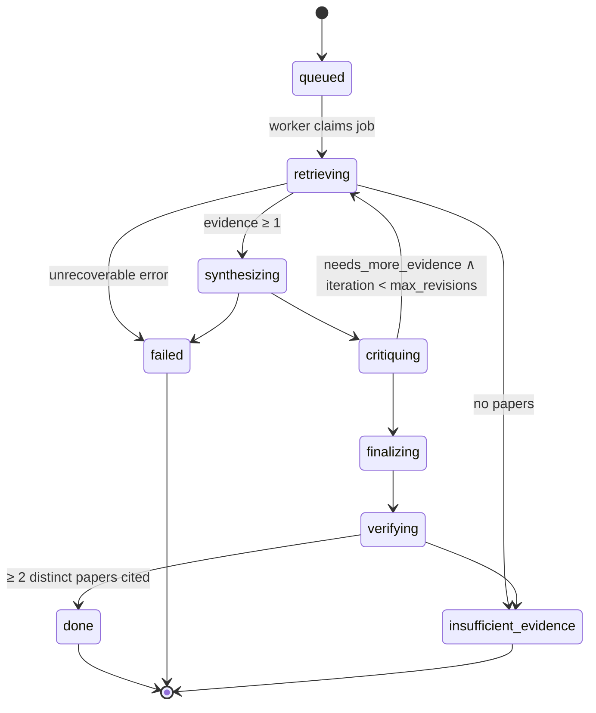
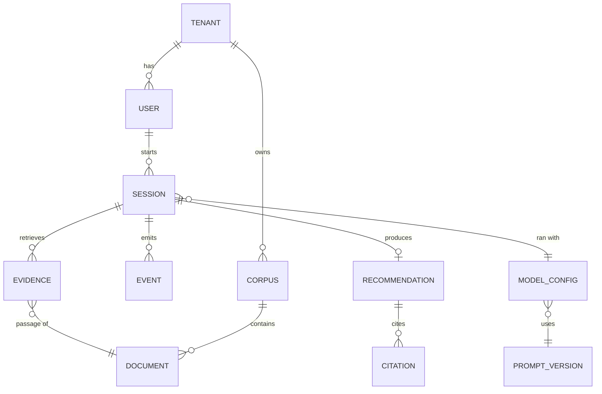
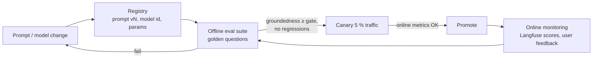
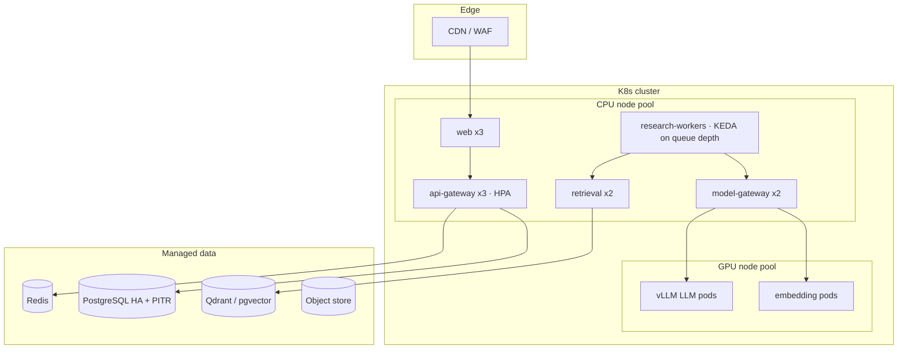

# Research Co-Scientist — Enterprise Architecture

> Target-state design for taking the working MVP (see [architecture.md](architecture.md)) to an
> organisation-wide, multi-team service. The MVP is the reference implementation of the *core
> domain*. This document adds what an enterprise needs around it: identity, tenancy, scale,
> governance, observability, evaluation and operations.

---

## 1. Context and drivers

| Driver | What it means for the design |
|---|---|
| Research teams want **trustworthy, cited** answers | Citation verification stays a hard gate in code, never a prompt instruction. |
| Data and IP stay **in-house** | Local / self-hosted models (Ollama today, vLLM at scale). No question or document leaves the network by default. |
| Several departments, **different data** | Multi-tenant: arXiv is shared, private corpora (internal reports, ELNs, patents) are per tenant. |
| Regulated environment (pharma, finance, gov) | Audit trail of every agent step, model version and prompt version; retention policies; RBAC. |
| Scarce GPUs | GPU capacity is the bottleneck. Queue, prioritise and meter by tenant. |
| Fast-moving model ecosystem | Swap models without code changes, and prove each swap with an offline eval. |

### Quality attribute targets

| Attribute | Target | How |
|---|---|---|
| Latency (end to end) | p50 < 90 s, p95 < 180 s | GPU pool, parallel searches, cache, streaming progress |
| Time to first feedback | < 1 s | Activity event emitted on enqueue |
| Availability | 99.5 % API, best effort for jobs | Stateless API, durable queue, idempotent jobs |
| Throughput | 50 concurrent users → ~20 jobs/min | Horizontal workers, scaled by queue depth |
| Groundedness | ≥ 95 % of cited ids verifiable, 0 fabricated citations shipped | Verifier gate plus offline eval |
| RPO / RTO | 1 h / 4 h | Postgres PITR, object-store versioning, rebuildable vector index |
| Cost visibility | Per-tenant GPU-seconds and tokens | Metering from traces |

---

## 2. Capability map



Each box is an independently ownable capability. The MVP implements Research core and Knowledge
(arXiv only) in one process. The target splits them along the lines below.

---

## 3. Logical architecture (target)



### Service responsibilities

| Service | Owns | Scales on | MVP equivalent |
|---|---|---|---|
| **Web app** | UX, live activity view, citation rendering | CDN / replicas | `web/` |
| **API gateway** | AuthN/Z, validation, quotas, session reads, SSE fan-out | CPU, replicas | `api.py` |
| **Research workers** | Workflow state machine, agents, verifier | Queue depth (KEDA) | `workflow.py`, `agents.py` |
| **Retrieval service** | Source connectors, rate limiting, caching, hybrid ranking | Requests | `retrieval.py` |
| **Model gateway** | Model routing, fallbacks, token/GPU metering, prompt-version tagging | Requests | direct Ollama call |
| **Model serving** | Batched inference | GPU count | Ollama on laptop GPU |
| **Ingestion pipeline** | Parse, chunk, embed, ACL-tag private documents | Batch | — |

**Why split the workers from the API.** LLM jobs run for minutes and hold GPU-bound resources.
Requests return in milliseconds. If both run in one process, a slow model stalls request handling
and scaling one forces scaling the other. The MVP's in-process `ThreadPoolExecutor` is the same
pattern in a single process: the queue becomes durable and the pool becomes a fleet.

---

## 4. Core workflow as an explicit state machine

The workflow is deterministic code that calls LLMs. The LLMs never decide control flow. This is the
key enterprise property: it is testable, auditable and bounded.



Enterprise additions to the MVP state machine:

- **Checkpoint after every state.** The worker persists `Session` and appends to `events` in
  Postgres. If a worker dies, another one resumes from the last completed state instead of
  restarting the job (idempotency key = `session_id + state + iteration`).
- **Per-state budgets.** Each state has a timeout and a token budget. Exceeding a budget is a
  `failed` with a typed reason, not a hang.
- **Human-in-the-loop hook (optional).** For regulated tenants, `verifying → awaiting_review →
  done` routes the answer to a reviewer before release.

---

## 5. Data architecture

| Store | Data | Classification | Retention | Notes |
|---|---|---|---|---|
| PostgreSQL | tenants, users, sessions, `events`, recommendations, audit log | Confidential | Sessions 1 y, audit 7 y | Row-level security keyed on `tenant_id` |
| Vector store | Passage embeddings + metadata (`tenant_id`, `source`, `acl`, `doc_id`) | Mirrors source | Rebuildable | Public arXiv in a shared collection; private corpora per tenant |
| Object store | Raw private documents, exported reports | Mirrors source | Per tenant policy | Versioned, encrypted with tenant key |
| Cache | arXiv / PubMed search results | Public | 24 h TTL | Shared across tenants, since it's public data |
| Trace store (Langfuse) | Prompts, completions, scores | Confidential | 90 d | PII redaction before export |

### Canonical entities



`SESSION → MODEL_CONFIG → PROMPT_VERSION` is what makes an answer reproducible and auditable. You
can always say which model, prompt and evidence produced a given recommendation.

### The event stream is the integration contract

The MVP's `Session.events` (`{t, agent, msg}`) grows into a versioned event schema:

```json
{ "v": 1, "session_id": "…", "tenant_id": "…", "seq": 17, "ts": "2026-11-19T10:04:12Z",
  "agent": "critic", "type": "agent.completed", "msg": "Confidence 62%, 2 unsupported claims",
  "data": { "confidence": 0.62, "needs_more_evidence": true }, "trace_id": "…" }
```

The same stream feeds the live UI (SSE), audit (append-only table) and analytics. Consumers depend on
the event contract, not on internal objects.

---

## 6. Security architecture

| Layer | Control |
|---|---|
| Identity | OIDC SSO through the enterprise IdP. Service-to-service via workload identity / mTLS. No shared API keys (the MVP's `X-API-Key` is dev-only). |
| Authorisation | RBAC roles `viewer`, `researcher`, `curator` (manages corpora), `admin`. Attribute check on every evidence passage: user ACL ∩ document ACL. |
| Tenancy | `tenant_id` on every row, vector and event. Postgres RLS. Vector queries always carry a tenant filter, enforced in the retrieval service rather than by callers. |
| Prompt injection | Evidence is wrapped as untrusted data (already in `_GROUNDING`). Agents have **no tools** that act on the world. The verifier rejects ids not in retrieved evidence. Output is rendered as text, never HTML. |
| Data egress | Models are self-hosted. The egress allow-list is limited to source APIs (arXiv, PubMed). No question text is sent to third parties, except the search keywords themselves. |
| Secrets | Vault / cloud KMS; nothing in env files in production. |
| Supply chain | Pinned images and lockfiles (`uv.lock`, `package-lock.json`), SBOM, image signing, model weights checksummed in the registry. |
| Audit | Append-only events table plus who/what/when on corpus and config changes. Exportable for compliance. |

**Threat model highlights**

1. A malicious paper abstract tells the model to cite something. *Mitigation:* the verifier gate
   (code), no tool access, and citations rebuilt from retrieved metadata only.
2. A cross-tenant leak through the vector store. *Mitigation:* the mandatory tenant filter lives
   in the retrieval service, plus an integration test that queries as tenant A and asserts zero
   B hits.
3. GPU exhaustion by one user. *Mitigation:* per-tenant quotas and priority queues at the gateway.

---

## 7. Model platform and LLMOps



- **Model gateway.** One interface for every agent call: `model_alias → (provider, model,
  params)`. Aliases like `synthesis-default` let ops swap `qwen3.5-4b` for a bigger model without
  a code change. The gateway handles retries, fallback models, structured-output enforcement and
  metering.
- **Serving.** vLLM on GPU nodes for throughput (continuous batching). Ollama stays the dev and
  edge runtime. Embeddings run on a separate small pool so ranking never queues behind generation.
- **Evaluation** (quality gate in CI):
  - *Groundedness*: share of claims whose cited passage supports them (LLM-as-judge plus a
    sampled human audit).
  - *Citation validity*: ids stripped by the verifier, target 0 per run.
  - *Retrieval*: recall@k on a labelled set of question → relevant papers.
  - *Calibration*: stated confidence against judged correctness.
  - *Ops*: p95 latency, tokens and GPU-seconds per session.
- **Prompt registry.** Prompts are versioned artifacts, not string literals, and every session
  records the versions it used.

---

## 8. Deployment architecture



- **Environments:** dev (Ollama + fake mode), staging (production-like, eval gate), prod.
  Promotion is GitOps (Argo CD), with infrastructure as code in Terraform.
- **Scaling rule:** workers scale on queue depth; GPU pods scale on pending inference
  requests. Plan GPU count from `jobs/min × GPU-seconds/job`. The MVP measured about 9 LLM calls
  per job and about 150 s on a 6 GB laptop GPU, so a production GPU running vLLM handles roughly
  10–20× that.
- **Resilience:** the API stays stateless. Jobs are at-least-once with idempotent state
  checkpoints. arXiv rate limiting is centralised in the retrieval service, with a token bucket
  in Redis so replicas share the 1 request per 3 s limit. Circuit breakers sit on external source
  APIs.

---

## 9. Observability

| Signal | Tooling | Key views |
|---|---|---|
| Traces | OpenTelemetry → Langfuse (LLM spans) and Tempo/Jaeger (service spans) | One trace per session: queue wait → each agent → each model call → verifier |
| Metrics | Prometheus / Grafana | Queue depth, job duration by state, GPU utilisation, tokens per tenant, verifier strip rate, insufficient-evidence rate |
| Logs | Structured JSON → Loki / ELK | Correlated by `trace_id` and `session_id` |
| Product | Event stream → warehouse | Questions per team, feedback 👍/👎, re-ask rate |

**Alerts:** p95 job duration > 180 s, queue wait > 60 s, verifier strip rate > 5 %, failure rate
> 2 %, GPU memory saturation.

---

## 10. Architecture decisions (ADR summary)

| # | Decision | Alternatives | Rationale |
|---|---|---|---|
| 1 | Deterministic workflow, LLMs only as steps | Autonomous tool-calling agent | Bounded cost and latency, auditable, works with small local models |
| 2 | Verifier in code is the release gate | Ask the model to cite carefully | Models fabricate ids; code cannot |
| 3 | Self-hosted models behind a gateway | Direct SaaS LLM calls | Data residency; swap models without code changes |
| 4 | Postgres as the system of record (+ RLS, pgvector option) | Many specialised stores | One HA store to operate; vector DB only when scale demands it |
| 5 | Event stream as the UI and audit contract | UI polls the full session | Decoupled consumers; SSE is cheap; audit for free |
| 6 | Durable queue + stateless workers | Long-running HTTP requests | Survives restarts; scales independently of the API |
| 7 | Chroma for the MVP, Qdrant/pgvector for production | Chroma in production | Chroma is ideal locally; production needs HA, tenant filters at scale, backups |

---

## 11. Migration roadmap: MVP → enterprise

| Phase | Scope | Exit criteria |
|---|---|---|
| **0. Today (done)** | Single process, Ollama, Chroma, in-memory sessions, polling UI with live activity log, Playwright e2e | Live run 156 s with verified citations; e2e green |
| **1. Durable core** (2–3 wks) | Postgres sessions + events, Redis queue, separate worker process, SSE instead of polling, structured logs + OTel | Kill a worker mid-job and the job resumes; no lost sessions on restart |
| **2. Trust** (2–3 wks) | OIDC SSO, RBAC, tenant_id everywhere + RLS, audit export, secrets in vault | Cross-tenant leak test passes; pen-test findings closed |
| **3. Quality** (2 wks) | Golden eval set (100 questions), Langfuse scoring, CI eval gate, prompt registry, user feedback | Groundedness ≥ 95 %; model swaps gated by eval |
| **4. Scale** (2–3 wks) | K8s, vLLM GPU pool, model gateway, KEDA autoscaling, shared rate limiter, Qdrant/pgvector | 50 concurrent users at p95 < 180 s in a load test |
| **5. Knowledge expansion** (ongoing) | PubMed / Semantic Scholar connectors, private corpus ingestion with ACLs, full-text PDFs, hybrid BM25 + vector, cross-encoder re-rank | Recall@10 improves over the abstracts-only baseline |

Each phase ships independently. The core domain code (`workflow.py`, `agents.py`, `verify`) carries
through unchanged; only the infrastructure around it changes.

---

## 12. Key risks

| Risk | Impact | Mitigation |
|---|---|---|
| Small local models produce invalid JSON or empty queries | Failed or poor sessions | Schema validation + retry, query sanitising (done), larger model via the gateway alias |
| Abstracts-only evidence is shallow | Weak recommendations | Full-text ingestion (phase 5), surfaced as a caveat meanwhile |
| GPU cost grows with adoption | Budget overrun | Per-tenant quotas, caching, smaller models for planner and critic |
| arXiv ToS / rate limits | Blocked IP | One shared rate limiter, 24 h cache, bulk metadata harvest (OAI-PMH) for hot topics |
| Over-trust in AI answers | Bad research decisions | Confidence and caveats shown prominently, inference kept apart from evidence, optional human review |
